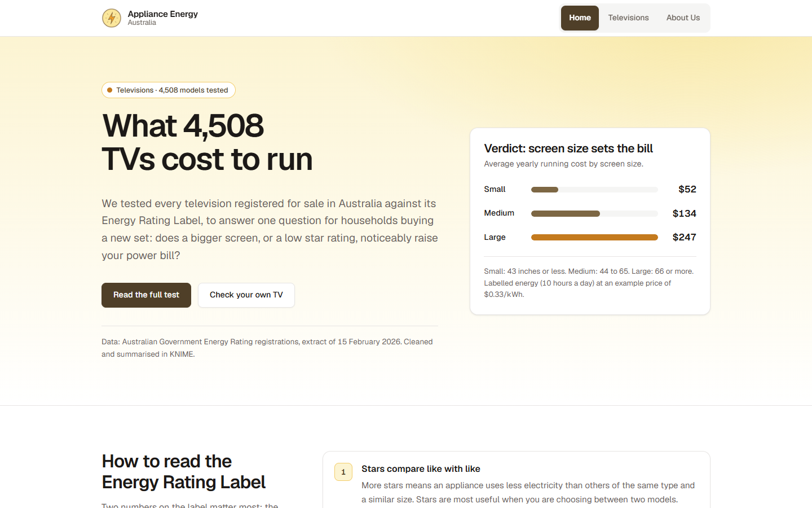
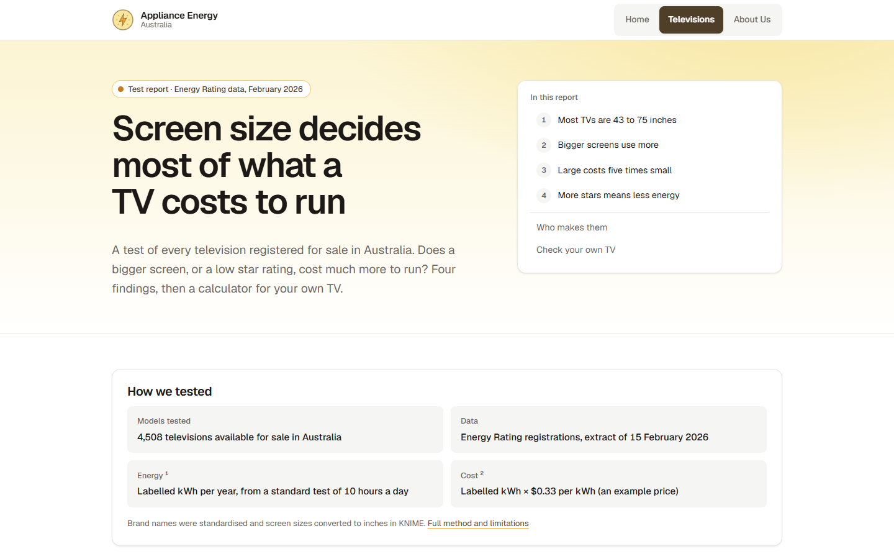

# Appliance Energy Australia

**Does a bigger screen, or a low star rating, really raise your power bill?** An interactive data story built on the Australian Government's Energy Rating data for 4,508 televisions, with a running-cost calculator so readers can check their own TV.

**Live site:** https://hienthong-vie.github.io/appliance-energy-australia/



## Highlights

- **Data pipeline in KNIME:** cleaned 4,724 raw registrations down to 4,508 models on sale in Australia. This meant standardising brand names (and fixing a duplicate-brand bug), converting screen sizes from cm to inches, grouping by size and star rating, and exporting tidy CSVs for the site.
- **Data story:** four findings that move from context to answer to action. They cover the size distribution, size vs energy, yearly cost by size group (large TVs cost about 5× more to run than small ones), and whether the star rating predicts running cost.
- **D3.js charts:** data loaded with `d3.csv()`, bound with `selectAll().data().join()`, and scaled with `scaleLinear`/`scaleBand`. The charts are responsive through `viewBox` and fall back to a static image if D3 can't load.
- **Energy calculator:** written in vanilla JavaScript, with per-field validation and live updates. It works out daily, monthly and yearly energy and cost, then draws a D3 chart comparing your TV with the average small, medium and large TV.
- **Accessible, responsive design:** a single CSS file with design tokens, a keyboard-friendly FAQ accordion, visible focus states, reduced-motion support, and layouts that work on phones and in print.

Built with HTML, CSS, vanilla JavaScript, D3.js v7 and KNIME. There is no framework and no build step.



## Pages

| Page | File | What it contains |
| --- | --- | --- |
| Home | `index.html` | Headline finding, a running-cost example from the data, how to read the Energy Rating Label, FAQ accordion |
| Televisions | `televisions.html` | Data story in four findings, takeaways, brand context, Appliance Energy Calculator |
| About Us | `about.html` | Audience, data source, processing, privacy, accuracy and limitations, ethics |

## Folder structure

```
/
  index.html
  televisions.html
  about.html
  assets/
    css/styles.css       all styling (one external stylesheet)
    js/main.js           footer year + FAQ accordion (all pages)
    js/barchart.js       D3 bar chart of yearly cost by screen size; switched off on the page (Finding 3 shows the KNIME image)
    js/report.js         bars grow in when scrolled into view; findings rail marks the current finding
    js/calcchart.js      D3 chart in the calculator results: your cost beside the average small, medium and large TV
    js/calculator.js     Appliance Energy Calculator (Televisions page)
    data/                CSV files exported from KNIME for the D3 charts
    img/PowerIcon.png    power logo
    img/charts/          chart images exported from KNIME
  docs/storyboard.png    storyboard of the reader journey
  docs/screenshots/      screenshots used in this README
  README.md
```

## Running locally

The calculator's D3 chart loads a CSV file, so the pages need to be served over HTTP. Run `python -m http.server` in this folder (or use VS Code's Live Server) and open `http://localhost:8000`. All paths are relative, so the same files work on any static host.

## Data Story

**Audience:** Australian households choosing a new television. They are not energy experts. They compare models in a shop or online, and care about the purchase price and the power bill.

**What they want to know:**
1. Does a bigger screen cost noticeably more to run?
2. Does the star rating on the label actually predict running cost?
3. How can they compare models when they buy?

**How the story is told:** The Televisions page moves from context to answer to action.
1. What sizes are on the market (histogram)
2. Energy use rises with size (scatter plot)
3. What that means in dollars per year for small, medium and large TVs (bar chart made in KNIME)
4. The star rating is a reliable guide to running cost (line chart made in KNIME)
5. Three takeaways, then the calculator so readers can try their own numbers, with a D3 chart comparing their cost with the average TVs

Each chart has a title that states the finding, a sentence or two of context, and a caption with the source.

**Storyboard:** see `docs/storyboard.png`, 7 frames following the reader through the Home page, the method, each finding and the calculator. Editable board: [FigJam](https://www.figma.com/board/v2rI7qZGKGD1WLEFM16USb).

## About the data

**Source:** Energy Rating registration data for televisions, published by the Australian Government ([energyrating.gov.au](https://www.energyrating.gov.au/)), extract `tv_2026_02_15.csv` (4,724 rows). Each row is one registered model. Column meanings come from the Energy Rating data dictionary.

**Processing (KNIME):**
- CSV Reader (data stored in the workflow data area so the exported workflow includes it)
- Missing Value check, and String Manipulation to trim and standardise brand names (for example `SAMSUNG ELECTRONICS` to `SAMSUNG`)
- Row Filter to keep models that are Available and sold in Australia
- Column Filter
- GroupBy brand, then Sorter (brand counts)
- Expression nodes to convert screen size from cm to inches and create a size category (small ≤ 43", medium 44 to 65", large ≥ 66")
- Expression node for an example yearly cost (labelled kWh × $0.33)
- GroupBy to get averages by size category, and by star rating (`Star2`; the `Star` column is almost empty)
- CSV Writer (quote values: never) to export the tables in `assets/data/`

**Privacy:** The data describes products, not people. There is no personal information, only brand and model details submitted by registrants.

**Accuracy and limitations:**
- Labelled energy comes from a standard test assuming 10 hours of viewing a day; real use varies.
- Standby power is not included in running costs.
- Some screen sizes (around 150 and 175 cm) may be misclassified; see the KNIME annotations for how these were checked.
- The data counts models, not sales.
- The electricity price is an example; tariffs vary by state and retailer.

**Ethics:** No brand or model is recommended. Bar charts start at zero. Small groups (for example, 8 models at 8 stars) are flagged so averages are not over-read.

## Context

Built by Chung Hien Thong for COS30045 Data Visualisation at Swinburne University of Technology.
